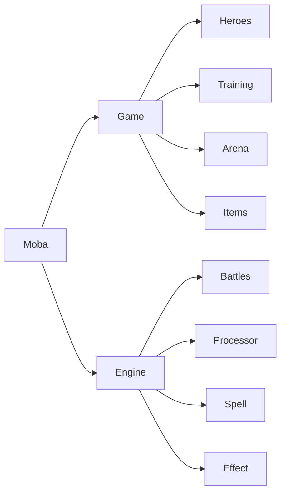
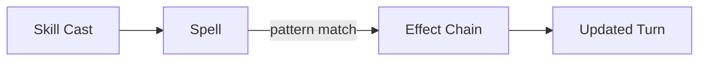

# MOBA - Multiplayer Online Battle Arena


[][discord]

A turn-based RPG built with Phoenix LiveView, online since 2020.

### [`PRESS START`](https://browsermoba.com/)

## Summary

**Stack:** Elixir 1.16 · Phoenix 1.8 · LiveView 1.1 · PostgreSQL

**Gameplay:** 24 avatars · 24 selectable skills + 24 ultimates · 30 items · 48 skins · 7 league tiers · 1v1 duels · 5v5 matches

---

## Technical Highlights

### Domain-Driven Architecture

`Game` orchestrates all gameplay modules. `Engine` orchestrates all battle-related modules. Both use `defdelegate` to expose clean public APIs.



**Key files:**
- [`lib/moba.ex`](lib/moba.ex) — Cross-domain orchestration
- [`lib/moba/game.ex`](lib/moba/game.ex) — Gameplay orchestrator
- [`lib/moba/engine.ex`](lib/moba/engine.ex) — Battle orchestrator

---

### Composable Battle Engine

Skills and items are defined as chains of small, pure effect functions. The `Spell` module uses pattern matching as a DSL for skill definitions.



**Key files:**
- [`lib/moba/engine/core/processor.ex`](lib/moba/engine/core/processor.ex) — Turn processing pipeline
- [`lib/moba/engine/core/spell.ex`](lib/moba/engine/core/spell.ex) — Skill/item definitions via pattern matching
- [`lib/moba/engine/core/effect.ex`](lib/moba/engine/core/effect.ex) — Composable effect functions

**Why this pattern:**
- Adding new skills requires only new function clauses
- Effects are pure functions, easy to test in isolation
- Battle logic completely decoupled from persistence

---

## Features

- **Hero Building** — Choose from 24 avatars, 24 normal skills, 24 avatar ultimates, and 30 items to train your custom hero
- **PvE Training** — Battle through 7 leagues and a boss fight to compete for the fastest completion time
- **Account Progression** — Master all playstyles with full account leveling and season leaderboards
- **Competitive PvP** — 5v5 team battles with skill brackets and 1v1 real-time duels

---

## Documentation

- [Product and game systems](docs/PRODUCT.md)
- [Design principles](docs/DESIGN.md)

## Installation

### Required tools

- Git and [asdf](https://asdf-vm.com/guide/getting-started.html), with the Erlang, Elixir, and Node.js plugins. Install the exact versions in [.tool-versions](.tool-versions) with `asdf install`.
- PostgreSQL server and client tools.

### Database configuration

Development defaults: `localhost:5432`, user/password `postgres` / `postgres`, database `moba_dev`. Tests use `moba_test`. See [dev.exs](config/dev.exs) and [test.exs](config/test.exs).

### Install dependencies and build assets

```bash
mix local.hex --force
mix local.rebar --force
mix deps.get
npm ci --prefix assets

(cd assets && node node_modules/webpack/bin/webpack.js --mode development)
```

### Seed and verify

Run once against an empty database:

```bash
mix ecto.setup
mix run priv/repo/check_setup.exs
```

`mix ecto.setup` creates the database, runs migrations, and executes [seeds.exs](priv/repo/seeds.exs). It supplies:

- An active season and an admin account: **`admin@browsermoba.com` / `123456`**, with 10,000 Shards.
- The complete [catalog](priv/repo/seed_catalog.json): 24 playable avatars plus the boss, 196 canonical skill rows including ranks/boss effects, 30 items, and 48 Master/Grandmaster skins.


### Run

```bash
mix phx.server
# Optional interactive shell: iex -S mix phx.server
```

Open [localhost:4000](http://localhost:4000), sign in at [/users/log_in](http://localhost:4000/users/log_in), then visit [/admin](http://localhost:4000/admin). Admin includes users, avatars, skills, items, skins, and LiveDashboard. The admin's player record is created on first login; progression starts normally. Use `PORT` to change the server port. Local email is available at [/dev/mailbox](http://localhost:4000/dev/mailbox).

Crucial runtime details:

- `mix resources` publishes canonical content edits; `mix bots` regenerates opponents afterward. Both change data. `mix tick` runs season matchmaking/ranking maintenance, which is not automatic in development.
- Local gameplay/admin need no external credentials. Discord linking/unlocks require your own OAuth configuration. Production additionally requires reviewing [prod.exs](config/prod.exs) and [runtime.exs](config/runtime.exs), replacing development credentials/secrets, and configuring the host, Discord bot, S3, and email delivery. These instructions provision a local development game.


### Tests

Seed a separate, empty test database once, then run the suite:

```bash
MIX_ENV=test mix ecto.setup
mix test
```

For a fresh test database, `mix seed_test` runs the complete setup and suite in the test environment, as GitHub Actions does.

[discord]: https://discord.gg/QNwEdPS
